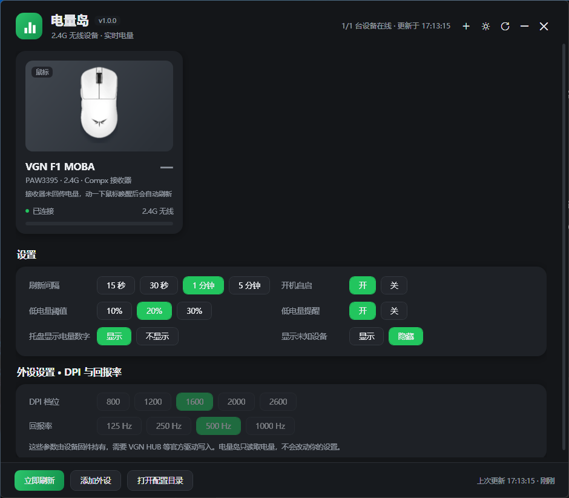
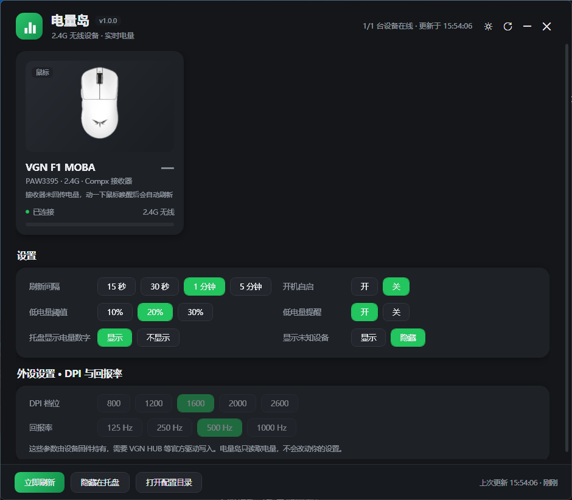
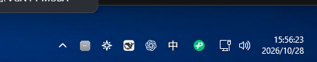
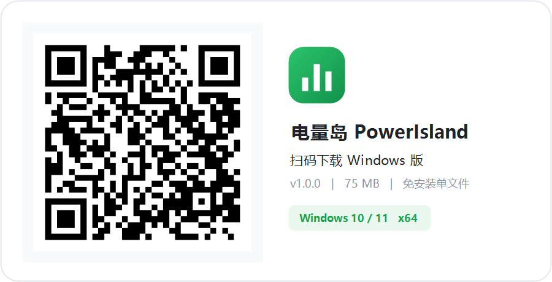

# 电量岛 PowerIsland

[](https://github.com/lingdiaoluo/power-island/actions/workflows/build.yml)
[](LICENSE)
[](https://dotnet.microsoft.com)
[](#已知限制)

<p align="center">
  <a href="https://github.com/lingdiaoluo/power-island/releases/latest">
    
  </a>
</p>

一个轻量的 Windows 外设电量小工具：**主面板 + 任务栏电量图标 + 悬停气泡**，原生读取无线鼠标／键盘／耳机的电量。

为 **VGN F1 MOBA** 做了原生协议支持，不需要安装 VGN HUB，也不改你的任何设备设置。



<p align="center">
  
  
</p>

## 特性

- **真实电量，不是估算**：走接收器的 HID 厂商通道直接读百分比，鼠标休眠时如实显示「—」
- **托盘常驻**：图标直接画出电量数字（`95`），低电量自动变橙／变红
- **悬停气泡**：鼠标移到托盘图标上，弹出所有设备的电量列表
- **添加外设**：右上角 `+` 打开型号列表，勾选你要监控的设备；没插的设备也会留在面板上显示「未连接」
- **多设备**：2.4G 接收器 + 蓝牙设备同时展示，一台一张卡片，带对应外观图（VGN 用实拍抠图，雷蛇毒蝰用白色实拍抠图，黑鲨用官方渲染图）
- **浅色 / 深色**两套自绘主题
- **低电量提醒**：低于阈值弹系统通知
- **开机自启**（可选）、刷新间隔、阈值全部可配
- **单文件分发**：自包含发布，双击即用，无需安装 .NET

## 支持设备

| 品牌 | 型号 | 协议 | 状态 |
| --- | --- | --- | --- |
| VGN | F1 MOBA / F1 Pro | Compx 17 字节 | 实测通过 |
| VXE | R1 Pro Max / R1 SE+ | Compx 17 字节 | 同源协议 |
| VXE | MAD R / MAD R Major+ | Compx 17 字节 | 同源协议 |
| ATK | F1 Ultimate / A9 Ultimate | Compx 17 字节 | 同源协议 |
| ATK | Zero | Compx 64 字节 | 同源协议 |
| Razer | 毒蝰 Viper V2 Pro（`0x00A6` / 有线 `0x00A5`） | 雷蛇经典 90 字节 | 已实现，待真机验证 |
| Razer | 旋风黑鲨 BlackShark V2 Pro 2020（`0x0528`） | 雷蛇经典 90 字节 | 实验性 |
| Razer | 旋风黑鲨 BlackShark V2 Pro 2023（`0x0555`） | 64 字节 PA/PI 帧 | 已实现，待真机验证 |
| 蓝牙 | 蓝牙鼠标 / 键盘 / 耳机 | Windows 设备电量属性（与「设置 → 蓝牙」一致） | 通用 |
| 其他品牌 | 实现了标准 HID Battery Strength 的设备 | HID Usage `0x06 / 0x20` | 自动探测 |

设备靠 **VID/PID + 厂商 HID 通道** 识别，不是按名字猜。新增型号只需在 `Services/VendorProtocols.cs` 的 `KnownDevices`（或 `RazerReader.Devices`）里加一行。

### 「任意品牌」的边界

程序对着三类通道依次尝试，能读到就显示：

1. 已知型号的**厂商私有协议**（上表前 8 行，最可靠）
2. **标准 HID 电量**：描述符里带 Usage Page `0x06` / Usage `0x20` 的设备，零配置直接读
3. **蓝牙**：Windows 自己上报的关联端点电量

第 2 类在实践中很稀少 —— 我在两台国产无线键鼠（VGN 接收器 + 小米键鼠套装，共 15 个 HID 接口）上实测**一个都没有**，
厂商基本都用私有帧。所以「插上任何品牌都能读」做不到；其余品牌需要按协议逐个适配，有 `docs/PROTOCOL.md` 里的方法可以照着加。

> 「添加外设」列表里除了内置型号，还会列出**当前实际扫到的**蓝牙设备和支持标准 HID 电量的设备，可以直接勾选。
> 设置里的「显示无电量设备」只是把剩下读不到电量的 HID 设备列出来看名字，标着「未开放电量接口」，不提供电量。

> 雷蛇 2023 款耳机换了固件协议，代码已按公开逆向结果实现，**尚未在真机上验证**。
> 如果你的设备读不到，`%APPDATA%\PowerIsland\app.log` 里会有原始的请求/应答十六进制，提 issue 时附上即可。

抓到新设备的数据却不知道怎么解析？见 [docs/PROTOCOL.md](docs/PROTOCOL.md)。

## 快速开始

### 直接用

到 [Releases](https://github.com/lingdiaoluo/power-island/releases/latest) 下载 **PowerIsland.exe**（约 75 MB），双击运行。

- 默认自动识别所有已插入的受支持外设；想固定监控某几台，点右上角 `+` 或底部「添加外设」勾选（列表会带上当前扫到的蓝牙设备）
- 关掉主窗口不会退出，程序留在托盘继续刷新；右键托盘图标 → `退出` 才是真正退出
- 首次运行如果托盘图标被 Windows 收进 `^` 折叠区，拖到任务栏固定即可（程序也会自动向系统申请常显）

<p align="center">
  
</p>

> 手机扫码可以直接打开下载页，把这张图发给朋友最省事。

### 自己编译

需要 [.NET 8 SDK](https://dotnet.microsoft.com/download/dotnet/8.0)（Windows）。

```powershell
git clone https://github.com/lingdiaoluo/power-island.git
cd power-island

# 调试运行
dotnet run --project PowerIsland/PowerIsland.csproj

# 发布单文件（自包含，约 75 MB）
dotnet publish PowerIsland/PowerIsland.csproj -c Release -r win-x64 `
  --self-contained true -p:PublishSingleFile=true `
  -p:IncludeNativeLibrariesForSelfExtract=true `
  -p:EnableCompressionInSingleFile=true -p:PublishTrimmed=false `
  -o publish
```

## 关于电量「—」

无线鼠标为了省电会休眠，休眠时接收器**不回应**电量查询——这是设备本身的行为，同类工具也一样。

程序在这种情况下显示 `—`，并且每 6 秒补刷一次：**鼠标一动，数字自己就回来了**，不用手动刷新。

## 设置项

| 设置 | 说明 |
| --- | --- |
| 刷新间隔 | 15 秒 / 30 秒 / 1 分钟 / 5 分钟 |
| 低电量阈值 | 10% / 20% / 30%，低于阈值图标变色并提醒 |
| 开机自启 | 写入 `HKCU\Software\Microsoft\Windows\CurrentVersion\Run` |
| 低电量提醒 | 系统气泡通知 |
| 托盘显示电量数字 | 开＝显示 `95`，关＝只画电量条 |
| 显示未知设备 | 列出读不到电量的 HID 外设，便于排查 |
| DPI / 回报率 | 只读展示。这些参数由固件持有，需要厂商驱动写入，本工具不会改你的设置 |

## 数据与卸载

- 配置：`%APPDATA%\PowerIsland\settings.json`
- 日志：`%APPDATA%\PowerIsland\app.log`（只记异常）
- 卸载：删除 exe 与该目录；若开过自启，先在设置里关掉

## 项目结构

```
PowerIsland/
├─ Interop/HidNative.cs        Win32 HID / SetupAPI 封装
├─ Services/
│  ├─ HidInventory.cs          枚举本机 HID 顶层集合
│  ├─ VendorProtocols.cs       Compx 电量协议 + 已知设备表
│  ├─ BluetoothBattery.cs      蓝牙设备电量（WinRT 关联端点）
│  ├─ DeviceService.cs         扫描、合并、刷新
│  ├─ TrayService.cs           托盘图标 / 菜单 / 悬停气泡
│  ├─ TrayIconFactory.cs       动态绘制带数字的图标
│  ├─ TrayHitTest.cs           Shell_NotifyIconGetRect 命中检测
│  └─ AppSettings.cs           配置、开机自启
├─ Models/
│  ├─ Peripheral.cs            设备模型
│  ├─ DeviceCatalog.cs         「添加外设」的型号目录
│  └─ DeviceArt.cs             外观图选择
├─ Services/RazerReader.cs     雷蛇 90 字节 / PA-PI 协议
├─ Views/AddDeviceDialog.xaml  添加外设对话框
├─ Themes/                     浅色 / 深色 / 设备外观图
└─ Views/                      主窗口、气泡
```

## 已知限制

- 只支持 Windows 10 1809+ / Windows 11（依赖 HID 与 WinRT 设备 API）
- 蓝牙电量依赖系统是否上报该属性，部分设备需要厂商驱动才会出现
- 未知协议的接收器读不到电量（会显示 `—`），欢迎提交 HID 报告描述符来补协议
- 托盘图标常显是通过系统的 `NotifyIconSettings\IsPromoted` 实现的，用户可随时在任务栏设置里改回

## 发版（维护者）

`tools/release.ps1` 把「编译 → 打 tag → 建 Release → 传 exe」合成一条命令：

```powershell
# 一次性准备：在 https://github.com/settings/tokens 生成带 repo 权限的 token
$env:GITHUB_TOKEN = "ghp_xxx"

# 发版，版本号会同时写进程序集
.\tools\release.ps1 -Version 1.0.1

# 自定义更新说明 / 先存草稿
.\tools\release.ps1 -Version 1.1.0 -Notes "新增 XXX 支持" -Draft
```

不传 `-Notes` 时，脚本会用上一个 tag 到 HEAD 的提交信息自动生成更新日志，
并在末尾附上文件大小和 SHA-256，方便使用者校验。

## 许可证

[MIT](LICENSE)

> 本项目为个人自制的非官方工具，与 VGN、VXE、ATK 等厂商无任何隶属关系。所有商标归其各自所有者。
